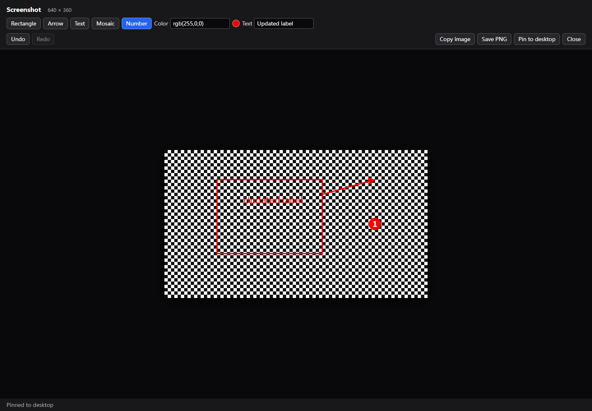
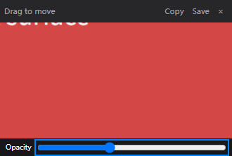

# Screenshots, annotations, and desktop pins

Implemented on the fork's `feat/screenshot-and-pin` branch, building on the global
controls branch used by [upstream PR #1137](https://github.com/webadderallorg/Recordly/pull/1137).
This is a screenshot workflow inside Recordly, with its own implementation. It does
not embed Snipaste or PixPin code, and it is not a complete replacement for either.

## Use

Run the changed application and click **Screenshot** on the idle recording HUD,
or press **Ctrl+Alt+S** on Windows / **Cmd+Option+S** on macOS. Customize or disable
the binding in **Home → Settings → Recording → Global recording shortcuts**.
Saved recording bindings are retained when the new action is introduced.

The app freezes each display before showing the shared capture picker. Drag an
area, adjust its handles, and press **Enter** or **Capture screenshot**. Clicking
a window selects its visible screen rectangle; this does not reveal obscured or
off-screen window contents. **Escape** or right-click cancels. The recording
source remains unchanged, and no video recording starts.

In the screenshot window:

- Draw rectangles, arrows, mosaic regions, or numbered markers.
- Enter a HEX or RGB color, e.g. `#ff4545` or `rgb(255,69,69)`.
- Choose **Text**, enter a label, and click to place it. The Text field can edit
  the most recently placed text until another tool is selected or history changes.
- Use **Undo / Redo**, or **Ctrl/Cmd+Z / Ctrl/Cmd+Shift+Z**.
- **Copy image**, **Save PNG**, and **Pin to desktop** all use the same flattened,
  annotated PNG at the captured pixel dimensions. Copy/save also have
  **Ctrl/Cmd+C / Ctrl/Cmd+S** shortcuts outside text inputs.

Pins remain above ordinary application windows. Move a pin by its title strip,
scroll over the image to resize it, adjust the opacity slider, or close it with
**× / Escape**. Each pin owns its image independently, so closing the annotation
window does not close its pins. Pin copy/save preserves the image pixels; window
size and opacity do not change the exported image.

## Capture and privacy boundaries

Screenshot capture currently supports Windows and macOS. Linux is explicitly
unsupported by this screenshot path; its existing recording picker is unchanged.
The screenshot picker supports rectangles on Windows even though the existing
Windows *video recording* picker still limits selection to screens/windows.

Each selection is restricted to one display. The image is captured at that display's
requested physical resolution; a capturer returning another resolution produces
an error instead of silently upscaling a thumbnail. Crop coordinates convert from
that display's DIP bounds to its PNG pixel bounds, including negative origins and
fractional scale factors. Display layouts changing during selection are not yet
covered by native acceptance.

The HUD is hidden before freezing the screen. Selection handles and annotation
controls are drawn afterward and are not part of the captured pixels. Protected
content can remain absent according to the OS capture policy. Screenshots and pins
remain in memory until explicitly saved; there is no screenshot history, disk
recovery, upload, OCR, or restart restoration. Closing an unsaved window or quitting
Recordly discards its in-memory image.

This change does **not** implement scrolling screenshots, clipboard-to-pin import,
arbitrary editing/moving of every existing annotation, a color eyedropper, or the
unified screenshot/GIF/MP4 action toolbar. Those remain separate product work.

## Validation

- Browser coverage: frozen Windows rectangle selection, negative display origin,
  annotation editing, arrow/number/mosaic, invalid colors, pixel-preserving undo and
  redo, matching PNGs across copy/save/pin, and pin opacity/zoom/close callbacks.
- Native IPC coverage: physical crop bounds, caller ownership, cancellation,
  resolution errors and retry, annotated copy/save/pin, independent pin lifetime,
  save cancellation, and refusal during recording/another selection.
- **Windows native run:** the real Electron desktop capturer and real picker UI
  cropped a controlled test window into a **300 × 150 PNG**, at display scale 1.
  The center BGRA pixel matched the test surface `[71,71,211,255]`. The save-dialog
  choice was automated; the PNG file write and image decode were real.
- The same native run copied an image to the system clipboard and read back its
  dimensions, then restored the previous supported clipboard formats. It also
  verified a real pin's always-on-top property, native opacity, wheel-driven size
  change, and window destruction through the close control.
- Native tests used an isolated user-data directory and a synthetic test surface;
  no installed application, user recordings, or user settings were replaced.

The screenshot editor and pin images below use synthetic content.

Real macOS capture/permission behavior, mixed-DPI native multi-monitor layouts,
native drag movement, and UU Remote delivery remain manual acceptance items.
Unit coordinate tests and browser bridge tests do not establish those outcomes.
